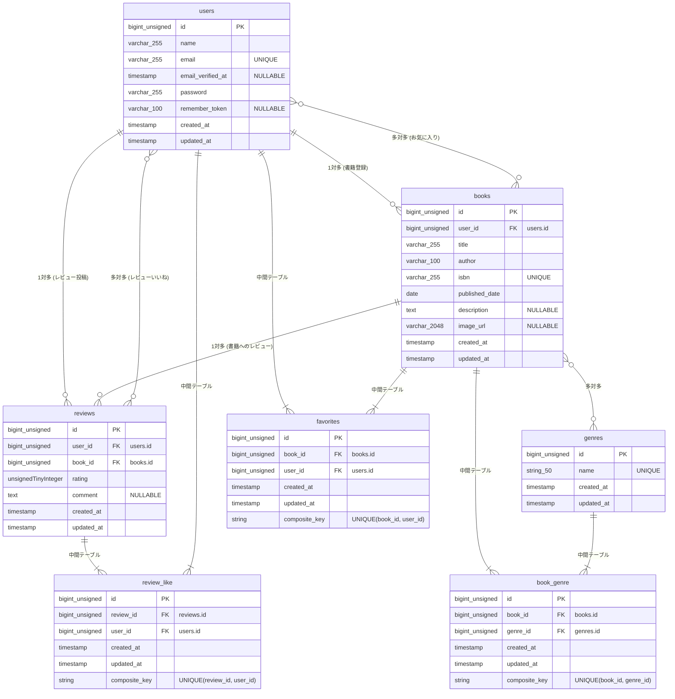

# BookShelf 書籍レビューアプリ

書籍の登録・閲覧、レビューの投稿やお気に入り管理ができる書籍レビューアプリケーションです。

## 概要

ユーザーが書籍に対して評価やコメントを残し、読書体験を共有・管理することを目的としています。
主要な機能として、ジャンルによる書籍の分類、レビューへのいいね機能、平均評価に基づくランキング機能を備えています。また、外部アプリケーション向けに書籍データの操作が可能な、認証不要の公開API（JSON）も提供します。

## ER図

## 環境構築手順

1. リポジトリをクローン

git clone -b basic https://github.com/coachtech-prepared-file/Preparedblade-mockcase-BookShelf.git
※応用はAdvancedブランチから再取得します。その為、上記basic部分をAdvancedと書き換えて、ターミナルで実行します。

2. Laravelプロジェクトの作成 (Laravel 10.x)

Docker Desktop（またはDocker Engine）が起動して、下記をターミナルに貼り付けて実行します。
docker run --rm -u "$(id -u):$(id -g)" -v "$(pwd):/var/www/html" -w /var/www/html -e COMPOSER_CACHE_DIR=/tmp/composer_cache laravelsail/php82-composer:latest composer create-project laravel/laravel:^10.0 bookshelf-app

3. Laravel Sailのインストール

先ほど作成したプロジェクトディレクトリにcd bookshelf-appで移動し、下記をターミナルに貼り付けて実行します。
docker run --rm -u "$(id -u):$(id -g)" -v "$(pwd):/var/www/html" -w /var/www/html -e COMPOSER_CACHE_DIR=/tmp/composer_cache laravelsail/php82-composer:latest composer require laravel/sail --dev

4. Sailの設定ファイルを生成する（MySQLを選択）

下記をターミナルに貼り付けて実行します。
docker run --rm -u "$(id -u):$(id -g)" -v "$(pwd):/var/www/html" -w /var/www/html -e COMPOSER_CACHE_DIR=/tmp/composer_cache laravelsail/php82-composer:latest php artisan sail:install --with=mysql

5. envファイルを確認する

.env ファイルを開き、データベース接続情報が以下と一致していることを確認します。

DB_CONNECTION=mysql
DB_HOST=mysql
DB_PORT=3306
DB_DATABASE=laravel
DB_USERNAME=sail
DB_PASSWORD=password

重要: DB_HOST は localhost や 127.0.0.1 ではなく、Dockerコンテナ名である mysql を指定します。

6. フロントエンドのセットアップ (Vite & Tailwind CSS)

本プロジェクトでは、フロントエンドのスタイリングにTailwind CSSを使用します。
以下の手順でセットアップを行ってください。

6-1. NPM依存パッケージのインストール
sail npm install
※Sailコンテナが起動していることを確認。起動していない場合は ./vendor/bin/sail up -d を実行

6-2. Alpine.jsのインストール
sail npm install alpinejs

6-3. Tailwind CSSと @tailwindcss/forms プラグインのインストール
sail npm install -D tailwindcss@^3.4.0 @tailwindcss/forms postcss autoprefixer
※ @tailwindcss/forms はフォーム要素のスタイルをリセットするLaravel標準プラグインです。

6-4. 設定ファイルの生成
sail npx tailwindcss init -p

6-5. Tailwind CSSのテンプレートパス設定とforms プラグインの有効化
tailwind.config.js をvscodeで開いて、以下の内容で上書きしてください。

import defaultTheme from 'tailwindcss/defaultTheme';
import forms from '@tailwindcss/forms';

/** @type {import('tailwindcss').Config} _/
export default {
content: [
'./vendor/laravel/framework/src/Illuminate/Pagination/resources/views/_.blade.php',
'./storage/framework/views/\*.php',
'./resources/views/**/\*.blade.php',
],
theme: {
extend: {
fontFamily: {
sans: ['Figtree', ...defaultTheme.fontFamily.sans],
},
},
},
plugins: [forms],
};

6-6. 本プロジェクトのresourcesファイルを1.リポジトリをクローンで取得したresourcesファイルと入れ替える。(Finderを開いて入れ替える)

6-7. Vite開発サーバーの起動
sail npm run dev
注意: 開発中は常にこのコマンドを実行した状態にしておいてください。

7. phpMyAdminの追加

vscodeで本プロジェクトのcompose.yaml を開き、mysql サービスの後に以下の設定を追加してください。

phpmyadmin:
image: 'phpmyadmin:latest'
ports: - '${FORWARD_PHPMYADMIN_PORT:-8080}:80'
    environment:
        PMA_HOST: mysql
        PMA_USER: '${DB_USERNAME}'
PMA_PASSWORD: '${DB_PASSWORD}'
networks: - sail
depends_on: - mysql

8. Sailの起動とエイリアス設定

    もう１つターミナルを開き、今回のプロジェクトまでターミナルでcdを使い移動する。移動できたら、ターミナルに下記を貼り付け実行し、Sailをバックグランドで起動。
    ./vendor/bin/sail up -d

# エイリアスを設定して 'sail' だけでコマンドを実行できるようにする

echo "alias sail='[ -f sail ] && bash sail || bash vendor/bin/sail'" >> ~/.zshrc

# シェルを再起動するか、新しいターミナルを開いてエイリアスを有効にする

exec $SHELL

9. アプリケーションキーの生成

ターミナルで下記を貼り付け実行して、アプリケーションキーを生成してください。
sail artisan key:generate

10. データベースのマイグレーションと初期データ投入

以下のコマンドでテーブルを作成し、初期データを投入します。
sail artisan migrate --seed

※既存のデータベースをリセットしたい場合は以下を実行してください。
sail artisan migrate:fresh --seed

※ 日本語化（バリデーション・認証メッセージ）について（基本） :
config/app.php の locale を ja にし、lang/ja/ にメッセージファイルを手動配置して行います。

## 使用技術

PHP: 8.5
Laravel: 10.x
DB: MySQL 8.4
フロントエンド: Vite, Tailwind CSS ^3.4.0, @tailwindcss/forms
開発ツール: Docker, Laravel Sail, phpMyAdmin

## 作成者

妹尾佑香

## APIエンドポイント一覧

認証不要の公開APIです。全エンドポイントは /api/v1 プレフィックス配下に定義されています。
| HTTPメソッド | URI | 概要 |
| :--- | :--- | :--- |
| `GET` | `/api/v1/books` | 書籍一覧を取得する |
| `GET` | `/api/v1/books/{book}` | 書籍詳細を取得する |
| `POST` | `/api/v1/books` | 書籍を新規登録する |
| `PUT` | `/api/v1/books/{book}` | 書籍を更新する |
| `DELETE` | `/api/v1/books/{book}` | 書籍を削除する |

## 開発環境URL

http://localhost
